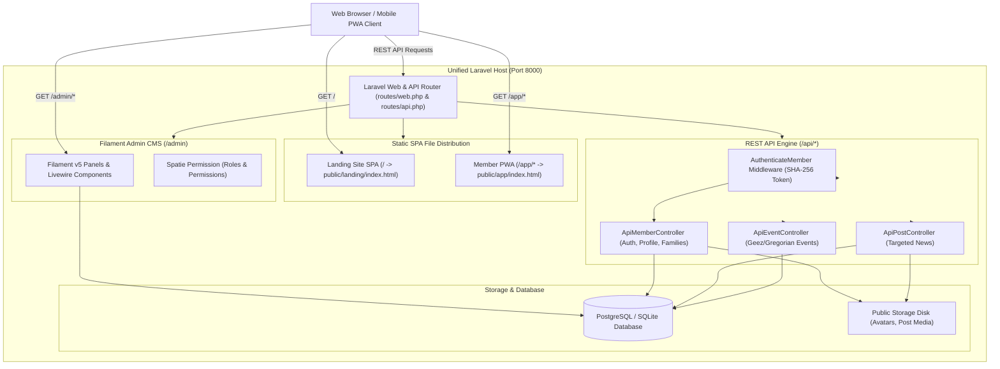
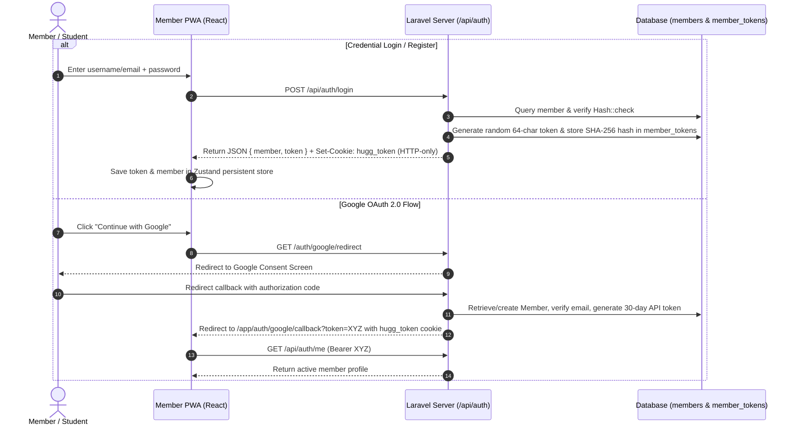
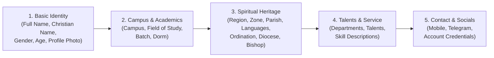
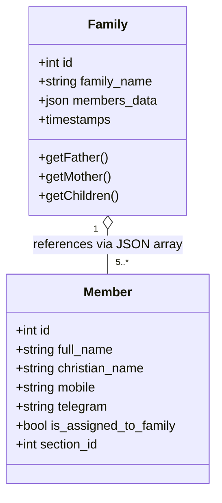
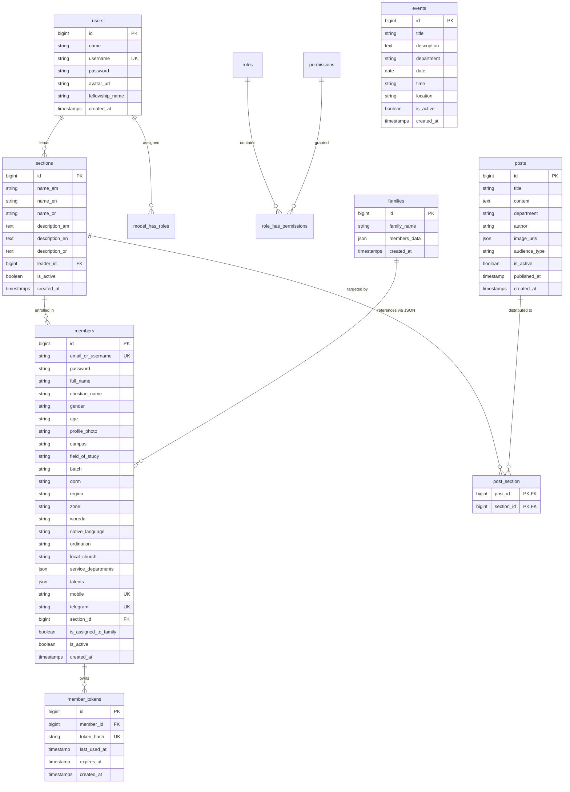

# HUGG (Haramaya University Gibi Gubae / ሐረማያ ዩኒቨርሲቲ ግቢ ጉባኤ)

[](#)
[](#)
[](#)
[](#)
[](#)
[](#)

---

## 📖 Executive Summary

**HUGG** is the enterprise digital platform for the **Haramaya University Orthodox Tewahedo Student Fellowship** (*ሐረማያ ዩኒቨርሲቲ ግቢ ጉባኤ*). Founded to serve hundreds of Orthodox Christian university students, HUGG modernizes and unifies fellowship operations across all campuses.

The platform provides an end-to-end ecosystem comprising:
1. **Public Showcase & Historical Portal (`landing`)**: A trilingual discovery portal showcasing fellowship heritage, service wings, weekly liturgical programs, and photo archives.
2. **Student Member Portal & PWA (`app_frontend`)**: An installable Progressive Web Application providing multi-step member onboarding, personalized announcements, dual Gregorian/Geez liturgical calendars, spiritual family mentorship management, and profile self-service.
3. **Core Backend & Administrative Engine (`server`)**: A Laravel 11/13 REST API coupled with a customized Filament v5 admin panel featuring granular Role-Based Access Control (RBAC), trilingual department administration, bulk family formation workflows, and audience-segmented content distribution.

---

## 🏛 System Architecture & Monorepo Topology

HUGG is engineered as a coordinated monorepo where the backend doubles as both a high-throughput REST API provider and the production host for the compiled frontends.

### Directory Structure

```plaintext
hugg/
├── package.json               # Root monorepo orchestrator (concurrent dev & build pipelines)
├── docker-compose.yml         # Container orchestration for server & database runtime
├── server/                    # Laravel 11/13 backend + Filament Admin Panel
│   ├── app/
│   │   ├── Enums/             # Section types & domain enumerations
│   │   ├── Filament/          # Filament v5 resources, widgets, custom pages & auth
│   │   ├── Http/
│   │   │   ├── Controllers/   # ApiMemberController, ApiEventController, ApiPostController
│   │   │   └── Middleware/    # AuthenticateMember (SHA-256 token verification)
│   │   └── Models/            # Eloquent models: Member, Family, Section, Post, Event, User
│   ├── database/              # Migrations, seeders (Admin, Roles/Permissions, Mock Members)
│   ├── routes/                # api.php (REST endpoints) & web.php (SPA hosting & OAuth)
│   └── public/                # Webroot containing compiled landing/ and app/ artifacts
├── app_frontend/              # React 19 + TypeScript + Vite + Tailwind CSS v4 PWA
│   ├── src/
│   │   ├── components/        # UI components (auth, calendar, family, news, registration)
│   │   ├── context/           # Zustand state stores (useAuthStore, useAppStore)
│   │   ├── hooks/             # Custom React hooks (theme, notification badges, filtering)
│   │   ├── i18n/              # Trilingual dictionary (Amharic, Afaan Oromoo, English)
│   │   ├── pages/             # App routing views (News, Calendar, Family, Profile, Wizard)
│   │   └── utils/             # API client, calendar utilities, theme switchers
│   └── public/                # PWA manifest, service worker (sw.js), brand icons
└── landing/                   # React 19 + Vite + Tailwind CSS v4 Showcase Site
    └── src/
        ├── components/        # Layout, top/bottom navigation bars, language switcher
        ├── pages/             # HomePage, AboutPage, BackgroundPage, BlackPage (Blog)
        └── i18n.js            # i18next multilingual engine
```

### High-Level Topology & Request Lifecycle



---

## 💻 Technology Stack Matrix

| Domain | Technology / Library | Version | Description & Architectural Role |
| :--- | :--- | :--- | :--- |
| **Backend Core** | [PHP](https://www.php.net/) | `^8.4` | Server-side execution engine configured with `intl`, `bcmath`, `pcntl`, `pdo_pgsql`. |
| **Backend Framework** | [Laravel](https://laravel.com/) | `^11 / ^13` | Application foundation, routing, Eloquent ORM, migration engine, and JSON responses. |
| **Admin Panel** | [Filament](https://filamentphp.com/) | `^5.0` | Server-driven administration panel, slide-over modals, bulk actions, and data tables. |
| **Authentication** | Custom Token + [Socialite](https://laravel.com/docs/socialite) | `^5.26` | SHA-256 hashed custom tokens in `member_tokens`, HTTP-only cookies, and Google OAuth 2.0. |
| **Authorization** | [Spatie Laravel-Permission](https://spatie.be/docs/laravel-permission) | `^7.3` | Granular role-based access control (`admin`, leaders, permissions per resource). |
| **Ethiopian Calendar**| [Andegna Calendar](https://github.com/andegna/calender) | `^2.4` | Geez / Ethiopian calendar conversions and date formatting. |
| **Frontend PWA** | [React](https://react.dev/) + [TypeScript](https://www.typescriptlang.org/) | `^19.2` / `~6.0` | Member portal SPA with strict typing, reactive hooks, and responsive UX. |
| **Frontend Routing** | [React Router](https://reactrouter.com/) | `^7.14` | Client-side routing with nested routes, protected authentication guards, and redirects. |
| **State Management**| [Zustand](https://zustand-demo.pmnd.rs/) | `^5.0` | Global state with `persist` middleware synchronization to `localStorage`. |
| **Animations** | [Framer Motion](https://www.framer.com/motion/) | `^12.38` | Smooth slide transitions for the 5-step registration wizard and modal views. |
| **Icons & UI** | [Lucide React](https://lucide.dev/) | `^1.7` | Modern vector icon set used across navigation bars, badges, and status widgets. |
| **Styling Engine** | [Tailwind CSS](https://tailwindcss.com/) | `^4.2` | Utility-first CSS using modern CSS variables for dual light/dark themes and church brand colors. |
| **Build Tools** | [Vite](https://vite.dev/) | `^8.0` | High-speed frontend bundling with output targeting directly to `server/public/`. |
| **Landing Portal** | React 19 + i18next | `^19.2` | Lightweight public showcase with responsive mobile bottom bar and image galleries. |
| **Containerization**| Docker & Docker Compose | Latest | Standardized container builds with Alpine Linux, host networking, and hot reloading. |

---

## ⚙️ Core Business Logic & Architectural Flows

### 1. Dual-Mode Authentication & Token Lifecycle

The application operates a specialized authentication mechanism tailored for both web browsers and mobile PWA devices:



#### Security Implementation Highlights
- **Exempted Cookie Encryption**: In `server/bootstrap/app.php`, the `hugg_token` cookie is excluded from Laravel's automated encryption. This enables the server to extract the plaintext token from either the `hugg_token` cookie or the HTTP `Authorization: Bearer <token>` header transparently.
- **SHA-256 Database Hashing**: The plaintext token is never persisted. Only its SHA-256 hash (`hash('sha256', $plainToken)`) is stored in the `member_tokens` table.
- **Throttled Timestamp Updates**: In `App\Http\Middleware\AuthenticateMember`, updates to `member_tokens.last_used_at` are throttled to occur at most once every 5 minutes to eliminate write saturation on database transactions during continuous polling.
- **Activation Gate**: Inactive accounts (`is_active = false`) are immediately halted with `403 Forbidden` (`Your account is deactivated.`).

---

### 2. Multi-Step Member Onboarding Wizard

When new students join the fellowship, they complete a structured 5-step registration process managed in `RegistrationPage.tsx` and validated on both client and server:



1. **Basic Info (`basic-info`)**: Full name, Christian baptismal name (*ስመ ክርስትና*), gender (`ወንድ` / `ሴት`), age, and profile photo upload.
2. **Campus & Academics (`campus-academics`)**: University campus (Main Campus, Harar, etc.), academic department/faculty, batch/year (`2016`, `2017`, `2018`), and campus dormitory.
3. **Background & Participation (`background-participation`)**: Regional origin (Region, Zone, Woreda), mother tongue and additional spoken languages, home parish church, and ecclesiastical ordination status (e.g., Deacon/*ዲያቆን*, ordination year, Diocese, and ordaining Bishop).
4. **Skills & Service (`skills-service`)**: Selection of ministry departments of interest (Bible study, mezmur choir, prayer, charity), personal artistic/musical talents, and detailed experience notes.
5. **Contact & Socials (`contact-social`)**: Mobile phone number, unique Telegram handle (`@username`), and account password.

---

### 3. Spiritual Family Mentorship Engine

A cornerstone of Orthodox student life is the **Spiritual Family** (*መንፈሳዊ ቤተሰብ*) structure. Students are grouped into intentional mentorship cells designed to prevent isolation and encourage spiritual growth.



#### Family Formation Logic
1. **Minimum Quorum Requirement**: An administrative rule requires at least **5 members** to form a family.
2. **Defined Family Roles**:
   - **Father (*አባት*)**: Senior mentor providing spiritual leadership.
   - **Mother (*እናት*)**: Senior mentor providing care and guidance.
   - **Children (*ልጆች*)**: 3 or more junior or batch-mate members.
3. **Filament Bulk Action Workflow**:
   - In `MemberResource.php`, administrators select members from the table and trigger the `Form Family` bulk action.
   - Validation checks confirm that none of the selected members have `is_assigned_to_family == true`.
   - The system creates a record in `families` storing structured JSON: `[{"member_id": 1, "role": "father"}, {"member_id": 2, "role": "mother"}, ...]`.
   - The system atomically marks all chosen members with `is_assigned_to_family = true`.
4. **Lifecycle Integrity**:
   - A model hook (`Family::booted`) triggers upon family deletion, automatically finding all referenced `member_id`s and setting their `is_assigned_to_family` back to `false`.

---

### 4. Ministry Sections & Dynamic Audience Targeting

Fellowship members belong to specialized ministry departments defined by the `SectionType` enum:
- **Bible Study (*የመጽሐፍ ቅዱስ ጥናት*)**
- **Mezmur Choir (*መዘምራን*)**
- **Youth Ministry (*ወጣቶች*)**
- **Children Teaching (*ህጻናት*)**
- **Prayer & Intercession (*ጸሎት*)**
- **Evangelism (*ወንጌል አገልግሎት*)**

#### Trilingual Model Design
Sections store descriptions and names in three official tongues:
- `name_am` / `description_am` (Amharic)
- `name_en` / `description_en` (English)
- `name_or` / `description_or` (Afaan Oromoo)

#### Content Audience Segmentation
Announcements and news posts (`posts` table) can be published with targeted distribution:
- `audience_type = 'all'`: Delivered to every registered member and public feeds.
- `audience_type = 'sections'`: Restricted via the `post_section` pivot table to only members who belong to those specific sections (`member.section_id IN (post.sections)`).

---

### 5. Calendar & Liturgical Scheduling

The student calendar bridges Western civil dates with the ancient Ethiopian liturgical calendar:
- **Ethiopian Date Conversion**: Utilizes `andegna/calender` on the backend and custom date-grid utilities on the frontend with Geez day abbreviations (`ሰ`, `ማ`, `ረ`, `ሐ`, `አ`, `ቅ`, `እ`).
- **Liturgical Fasting & Feast Dates**: Highlighted alongside fellowship gatherings, choir practices, and tutorial sessions.
- **Event Filtering**: Members can filter schedules by date, venue, and organizing department.

---

## 🗄 Database Architecture & Entity Relationships



---

## 🔌 API Specification & Reference

Base URL prefix: `/api`

### Public Authentication & Discovery

| Method | Endpoint | Description | Key Parameters / Request Body |
| :--- | :--- | :--- | :--- |
| `POST` | `/auth/register` | Register new member and issue session token | `{ full_name, email_or_username, password, password_confirmation, batch, ... }` |
| `POST` | `/auth/login` | Authenticate with credentials | `{ email_or_username, password }` |
| `GET` | `/auth/check-identifier` | Real-time uniqueness validation | `?value=...&type=email\|phone\|telegram` |
| `GET` | `/auth/google/redirect` | Initiate Google OAuth 2.0 redirect | None |
| `GET` | `/auth/google/callback` | OAuth callback returning token/cookie | OAuth state and code query parameters |

### Content & Fellowship (Public / Member)

| Method | Endpoint | Description | Query Filters |
| :--- | :--- | :--- | :--- |
| `GET` | `/posts` | Retrieve published news announcements | `?department=...&section_id=...` |
| `GET` | `/events` | Retrieve fellowship calendar events | `?date=YYYY-MM-DD&department=...` |
| `GET` | `/families` | Retrieve family listings (scoped by query) | `?member_id=...&section_id=...` |
| `GET` | `/families/{id}` | Retrieve single family with member cards | Route parameter `{id}` |

### Protected Member Endpoints (`auth.member` Middleware)

Requires `Cookie: hugg_token=...` or `Authorization: Bearer <token>`.

| Method | Endpoint | Description | Request Body / Payload |
| :--- | :--- | :--- | :--- |
| `GET` | `/auth/me` | Fetch authenticated member's profile | None |
| `POST` | `/auth/logout` | Revoke current active token & clear cookie | None |
| `PATCH` | `/members/{id}/profile` | Self-service profile updates | Multipart / JSON fields (`full_name`, `dorm`, `mobile`, `talents`, etc.) |
| `GET` | `/members` | List members (restricted) | Pagination & filter parameters |
| `GET` | `/members/{id}` | Fetch individual member profile | Route parameter `{id}` |

---

## 🚀 Development, Build & Deployment Guide

### Prerequisites
- **Node.js**: `v20.x` or `v22.x`
- **npm**: `v10.x` or higher
- **PHP**: `^8.3` or `^8.4` with extensions: `pdo`, `pdo_pgsql` / `pdo_sqlite`, `intl`, `bcmath`, `zip`, `pcntl`
- **Composer**: `v2.x`
- **Docker & Docker Compose** (optional, for containerized environment)

---

### Step 1: Clone Repository & Install Dependencies

You can install all frontend and backend dependencies using the root workspace helper script:

```bash
# Clone the repository
git clone <repository-url>
cd hugg

# Install dependencies across landing, app_frontend, and server
npm run install:all
```

Alternatively, install individually:
```bash
# Frontend PWA
cd app_frontend && npm install && cd ..

# Landing Portal
cd landing && npm install && cd ..

# Laravel Backend
cd server && composer install && cd ..
```

---

### Step 2: Environment Configuration

Create the server environment file:

```bash
cd server
cp .env.example .env
php artisan key:generate
```

Configure your `.env` variables according to your database:
```ini
APP_NAME=HUGG
APP_ENV=local
APP_KEY=base64:...
APP_DEBUG=true
APP_URL=http://localhost:8000

# Database Configuration (PostgreSQL or SQLite)
DB_CONNECTION=pgsql
DB_HOST=127.0.0.1
DB_PORT=5432
DB_DATABASE=hugg_db
DB_USERNAME=postgres
DB_PASSWORD=secret

# Google OAuth Credentials (Optional for local testing)
GOOGLE_CLIENT_ID=your-google-client-id
GOOGLE_CLIENT_SECRET=your-google-client-secret
GOOGLE_REDIRECT_URL=http://localhost:8000/auth/google/callback
GOOGLE_FRONTEND_REDIRECT_URL=http://localhost:5173/auth/google/callback
```

Run database migrations and seed default data:
```bash
php artisan migrate
php artisan db:seed
```

> **Default Seeded Admin Credentials**:
> - Username: `admin`
> - Password: `password`

Create storage symbolic link for member avatars and media:
```bash
php artisan storage:link
cd ..
```

---

### Step 3: Running Development Servers

Start all three services concurrently (Backend, Member PWA, and Landing):

```bash
npm run dev
```

This launches:
- **Server API & Admin**: `http://127.0.0.1:8000` (Admin panel at `http://127.0.0.1:8000/admin`)
- **Member Portal PWA**: `http://localhost:5173` (Proxies `/api` and `/auth` to port 8000)
- **Landing Showcase**: `http://localhost:5174`

---

### Step 4: Production Compilation & Unified Distribution

When building for production, the Vite configurations compile assets directly into the Laravel public webroot:
- `landing/` builds into `server/public/landing/` (served at `/`)
- `app_frontend/` builds into `server/public/app/` (served at `/app/*`)

To trigger a full build:

```bash
npm run build:all
```

Once built, starting the Laravel server serves the complete application from a single entry point:
```bash
cd server
php artisan serve --port=8000
```
- Landing Page: `http://localhost:8000/`
- Member PWA: `http://localhost:8000/app`
- Admin Panel: `http://localhost:8000/admin`
- REST API: `http://localhost:8000/api`

---

### Step 5: Docker Containerization

To run the backend inside the production Docker container:

```bash
# Build and launch using Docker Compose
docker compose up -d --build

# Run migrations inside the container
docker compose exec server php artisan migrate
```

---

## 🌐 Multilingual Support (i18n)

HUGG supports three languages to reflect the student community:

| Language | Code | Script / Native Name | Target Surfaces |
| :--- | :--- | :--- | :--- |
| **Amharic** | `am` | አማርኛ | Default language across landing, PWA, and liturgical descriptions. |
| **Afaan Oromoo** | `om` | Afaan Oromoo | Fully localized navigation, department definitions, and headers. |
| **English** | `en` | English | Universal interface language and API reference. |

---

## 👥 Roles & Permissions Matrix

Powered by `spatie/laravel-permission` under the `internal` admin auth guard:

| Role / Scope | Members | Families | Sections | Posts | Events | Users & Roles |
| :--- | :---: | :---: | :---: | :---: | :---: | :---: |
| **Super Admin** | Full CRUD | Full CRUD & Bulk Form | Full CRUD | Full CRUD | Full CRUD | Full CRUD |
| **Section Leader** | View / Edit Section Members | View Led Families | View Led Section | Create / Edit Section Posts | Create / Edit Section Events | No Access |
| **Registered Member** | Self Profile Update | View Assigned Family | View Enrolled Section | Read Targeted Posts | Read Events | No Access |
